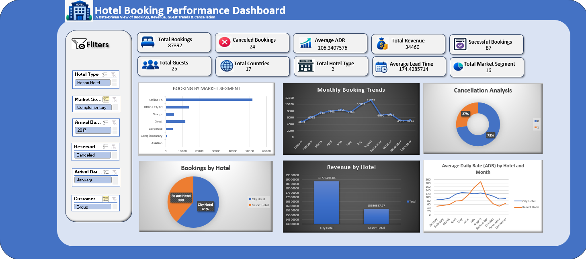

# 🏨 Hotel Booking Performance Dashboard – Excel

## Project Overview

The **Hotel Booking Performance Dashboard** is an interactive Microsoft Excel dashboard designed to analyze hotel booking performance, cancellation patterns, revenue trends, guest information, and market segment performance.

The dashboard uses Pivot Tables, Pivot Charts, Excel Slicers, and data visualization techniques to transform hotel booking data into meaningful business insights.

## Dashboard Preview

## Project Objectives

- Analyze overall hotel booking performance.
- Monitor monthly booking trends.
- Understand booking cancellation patterns.
- Compare booking performance between City Hotels and Resort Hotels.
- Analyze revenue contribution by hotel type.
- Understand Average Daily Rate (ADR) trends across different hotels and months.
- Explore booking distribution across different market segments.
- Provide interactive filtering for better analysis.

## Key Performance Indicators (KPIs)

The dashboard tracks the following KPIs:

| **KPI** | **Description** |
|---|---|
| Total Bookings | Overall number of hotel bookings |
| Canceled Bookings | Number of canceled bookings |
| Average ADR | Average Daily Rate of hotel bookings |
| Total Revenue | Total revenue generated |
| Successful Bookings | Number of successful bookings |
| Total Guests | Total guests represented in the filtered data |
| Total Countries | Number of countries represented |
| Total Hotel Type | Number of hotel categories |
| Average Lead Time | Average number of days between booking and arrival |
| Total Market Segment | Number of market segments represented |

## Dashboard Visualizations

The dashboard includes the following visualizations:

### 1. Booking by Market Segment
- Displays bookings across different market segments.
- Compares Online TA, Offline TA/TO, Groups, Direct, Corporate, Complementary, and Aviation.
- Identifies the major booking channels.

### 2. Monthly Booking Trends
- Tracks monthly hotel bookings.
- Highlights changes in booking patterns throughout the year.
- Helps identify months with higher and lower booking activity.

### 3. Cancellation Analysis
- Visualizes the distribution of canceled and non-canceled bookings.
- Helps understand the proportion of booking cancellations.

### 4. Bookings by Hotel
- Compares booking distribution between City Hotels and Resort Hotels.
- Shows the contribution of each hotel type to total bookings.

### 5. Revenue by Hotel
- Compares revenue generated by City Hotels and Resort Hotels.
- Helps identify which hotel type contributes more to total revenue.

### 6. Average Daily Rate (ADR) by Hotel and Month
- Compares monthly ADR between City Hotels and Resort Hotels.
- Highlights changes in average room rates.
- Helps understand pricing trends across both hotel types.

## 🎛️ Interactive Features

The dashboard includes interactive Excel slicers for:

- Hotel Type
- Market Segment
- Arrival Date Year
- Reservation Status
- Arrival Date Month
- Customer Type

Users can select different filters to dynamically explore hotel booking performance and analyze specific booking trends.

## Tools & Technologies Used

- Microsoft Excel
- Excel Tables
- Pivot Tables
- Pivot Charts
- Excel Slicers
- Excel Formulas
- Data Analysis
- Data Visualization
- Dashboard Design

## Project Objective

The main objective of this project is to analyze hotel booking data and present meaningful insights into booking trends, cancellations, revenue generation, hotel performance, and customer segments through an interactive Excel dashboard.

---

**Created using Microsoft Excel**
